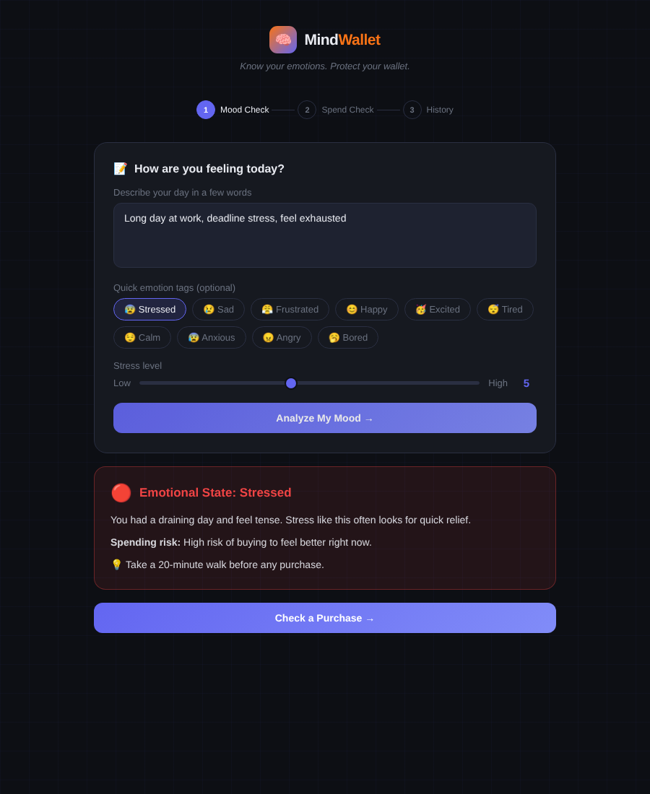
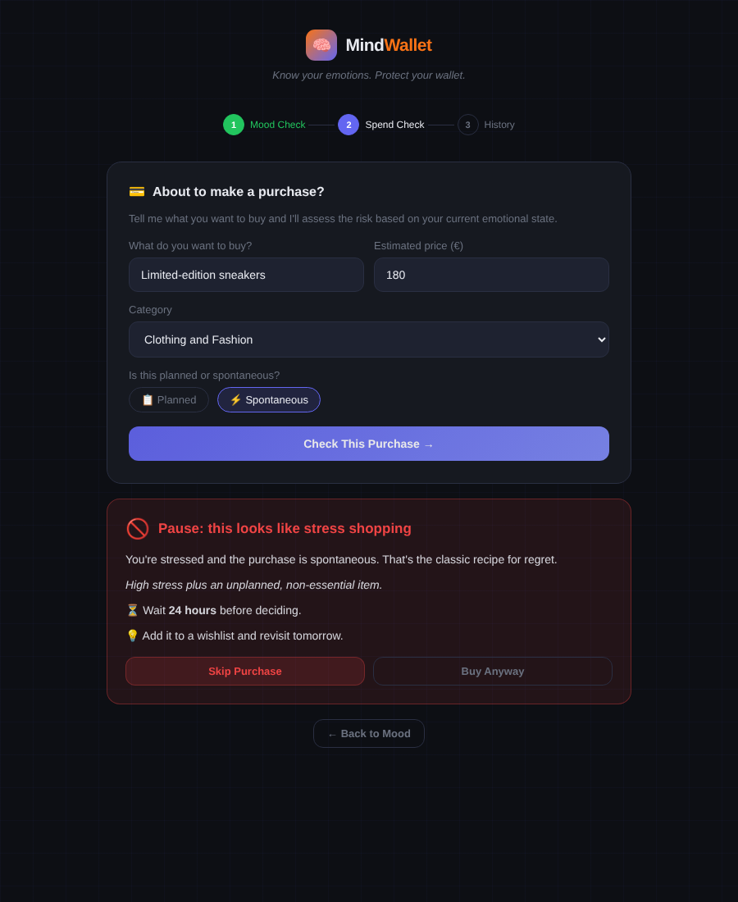
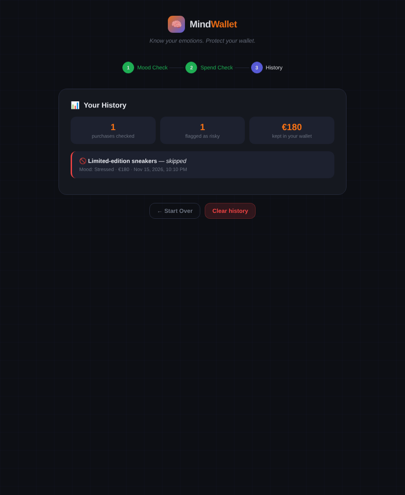

# 🧠 MindWallet

**Know your emotions. Protect your wallet.**

MindWallet is an AI coach for **emotional spending**. Before a purchase, you describe how you feel. The app works out your emotional state and how risky it is for spending. Then it judges the specific purchase you're considering: **block**, **warn** or **allow**, with a suggested waiting time and a concrete tip. Every decision is logged, so you can see how much money you kept.

It applies behavioural economics in practice: stress, sadness or boredom combined with a spontaneous, non-essential purchase is the classic recipe for regret.

| 1 · Mood check | 2 · Spend check | 3 · History |
|---|---|---|
|  |  |  |

<sub>Screenshots show example AI answers.</sub>

## How it works

1. **Mood check:** free-text description of your day, emotion tags and a stress level (1–10). The LLM returns a structured JSON verdict: primary emotion, risk level (low / medium / high), summary, spending risk and advice.
2. **Spend check:** item, price, category, planned or spontaneous. The LLM combines this with your emotional state and returns `block` / `warn` / `allow`, its reasoning, an optional *wait N hours* cooling-off period, and a tip.
3. **Decision and history:** skip, postpone, proceed or buy anyway. Decisions are saved in the browser, with totals for purchases checked, risky purchases flagged, and **money kept in your wallet** (the price of skipped and postponed purchases).

## Architecture

```
mindspend.html  (UI, vanilla JS)
      │  POST /api/chat  { system, messages }
server.js       (Node.js, no dependencies)
      │  holds GROQ_API_KEY, validates input, asks for JSON output
Groq API        (Llama 3.3 70B)
```

- The **API key stays on the server**: it's read from an environment variable or a `.env` file, and never sent to the browser
- The model is asked for a strict JSON object (`response_format: json_object`), so answers can be parsed reliably
- Every AI answer and user input is HTML-escaped before display
- History is stored in `localStorage`. No account and no database; data stays on your device

## Getting started

Requires **Node.js 18+** and a free [Groq API key](https://console.groq.com/keys).

```bash
git clone https://github.com/YusfAI/MindWallet.git
cd MindWallet
cp .env.example .env      # Windows: copy .env.example .env, then paste your key in .env
npm start                 # → http://localhost:3000
```

| Variable | Default | |
|---|---|---|
| `GROQ_API_KEY` | (required) | Groq API key |
| `PORT` | `3000` | Server port |
| `GROQ_MODEL` | `llama-3.3-70b-versatile` | Any Groq chat model |

## Roadmap

- Currency selector (TND / EUR / USD)
- Weekly view: which emotions trigger the most risky purchases
- Optional account and sync across devices

## Tech stack

HTML · CSS · vanilla JavaScript · Node.js (`http`, built-in `fetch`) · Groq (Llama 3.3 70B)

## Author

**Youssef**, Business Intelligence student at IHEC Carthage · [GitHub](https://github.com/YusfAI)

*MindWallet gives behavioural nudges, not financial advice.*
